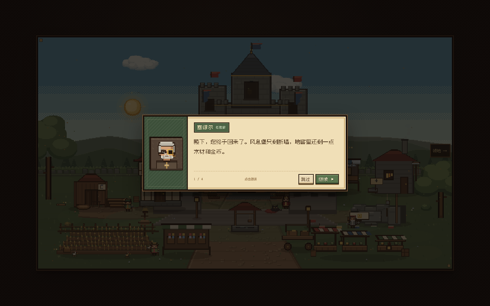
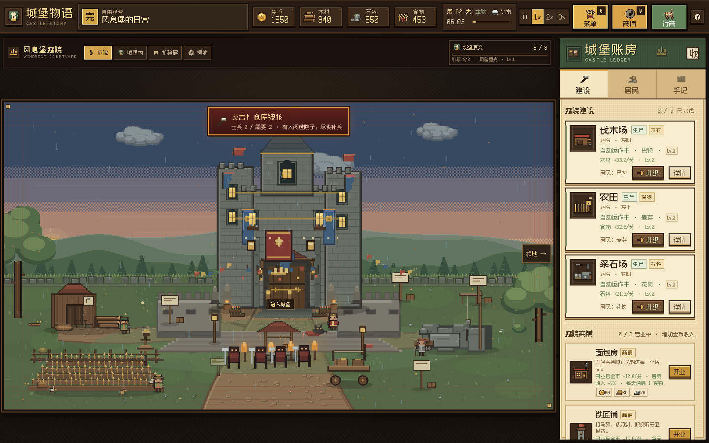
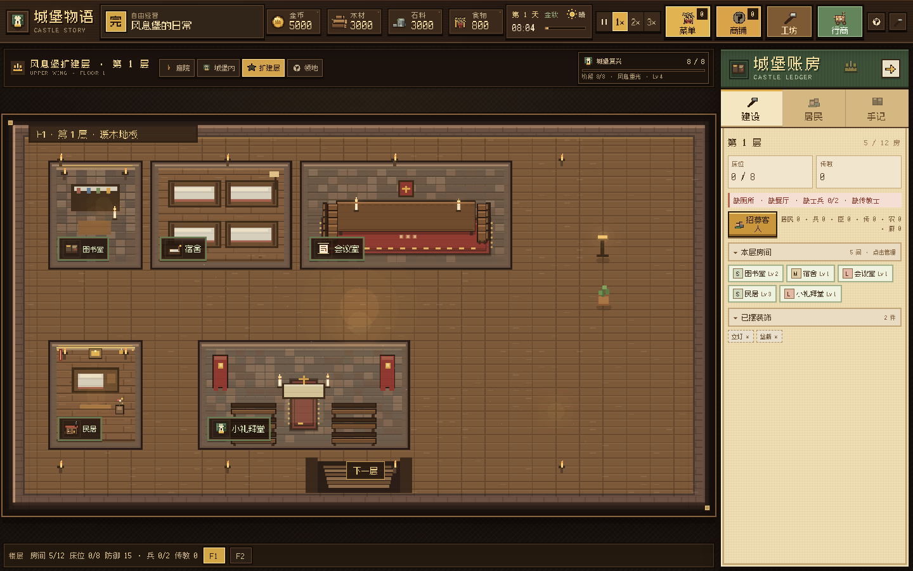
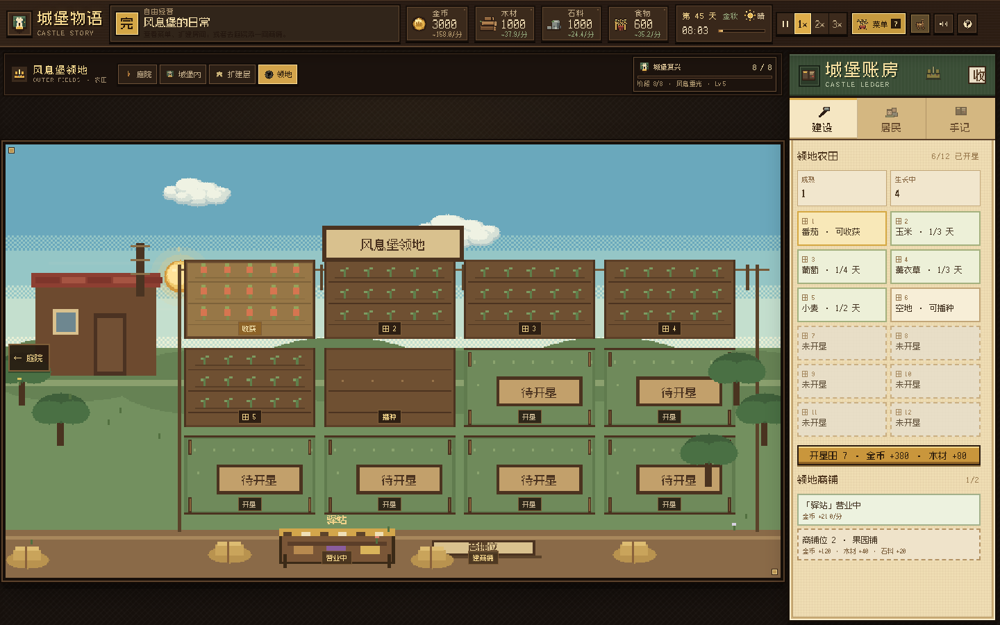
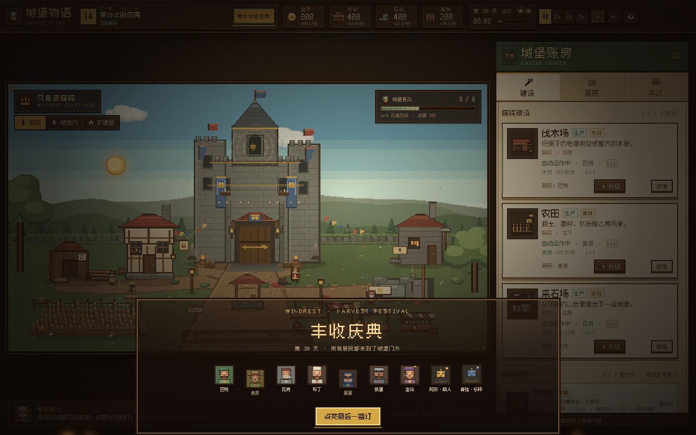

# 城堡物语 · 废墟上的王冠 v5

一款单页 HTML 像素风城堡模拟经营游戏。修庭院、卖资源、修复城堡，然后把城堡向上扩建为有不同尺寸房间、不同客人职业、防御与偷窃、传教士与产能、以及阶段外观变化的多层城堡。

**在线试玩：<https://gigige1999.github.io/midagetown/>**








## 运行

直接双击 `index.html`；或：

```bash
python3 -m http.server 8765
# http://127.0.0.1:8765
```

无依赖、无构建。场景、人物、图标全部由 Canvas 程序化绘制。

## v5 重点

### 1. 城堡阶段会改变外观（领地整体扩张）

每完成一个区域，城堡都会进入下一阶段，并增加新的外观元素：

- 门灯、旗帜、庭院花圃、城门彩旗；
- 大门上方的家族旗帜、亮窗、金环；
- 石像、金冠、彩灯；
- 高等级时还会加建两侧塔楼。

进度浮窗会显示 `阶段 X/8`、城堡等级和威望；阶段提升时会有专门提示。

### 2. 扩建层：每层 10 个不同大小的房间位

- 每层 10 个位置，尺寸分为 S / M / L。
- 小位置只能放小型房；中型位置可放小/中型；大型位置可放任意房。
- 房间类型可重复，位置由玩家选择。
- 一层建满 10 间后，下一层会自动解锁；可持续向上扩建。
- 点击画面底部的楼梯可以直接进入下一层；还没建满时会提示先完成本层。
- 16 种房间：厕所、餐厅、卧室、宿舍、工坊、花园房、图书室、浴场、武器库、书房、会议室、小礼拜堂、民居、士兵营房、大臣办公室、静修室。

### 3. 地板与装修有独立入口

- 场景上方新增「装修」按钮，不放进房间升级流程。
- **城堡内部**：一次购买城堡内部装修，整套大厅/房间地砖与中央地毯同步变化。
- **扩建层**：按楼层独立购买地板皮肤，默认灰石砖；暖木、黑白棋盘、青苔石、皇家红石。
- 购买只解锁当前层；另一层需要单独购买。
- 场景会同步改变地砖、走廊地毯、房间地面色调，并在楼层标题显示皮肤名。
- 城堡大厅入口同时有「城堡装修」按钮，不占用房间升级弹窗。
- 大厅装修只按套装出售：每个套装会同时改变地板、墙面整体配色和陈设（皇家红金 / 暖木田园 / 棋盘书卷 / 苔石礼拜），买完立即整厅换色。

### 4. 四类客人，各有不同需求与效果

| 客人 | 本层房间要求 | 效果 |
|---|---|---|
| 居民 | 民居 | 提高金币收入 |
| 士兵 | 厕所 + 武器库 + 士兵营房 | 提高防御，降低被偷窃概率 |
| 大臣 | 会议室 + 书房 + 大臣办公室 | 每个 +6% 生产；房间和招募更贵 |
| 传教士 | 小礼拜堂 + 静修室 | 恢复居民产能，提高满意度 |

- 每位客人都会消耗食物，并占用所在楼层的一个床位。
- 不同职业有不同头像、服装和职业道具，会在对应房间/区域活动。
- 客人的招募条件按“当前楼层”的房间计算，因此每层都需要做配比规划。
- 角色房：民居（居民）、士兵营房（士兵）、大臣办公室（大臣）、静修室（传教士）。

### 5. 防御、偷窃、传教士与户外巡逻

- 士兵会穿着头盔、带着武器在城堡门外站岗和沿路巡逻，不再是只出现在房间里的小图标。
- 士兵与武器库提供防御。
- 居民越多，需要的士兵越多；士兵不足时，隔壁村可能在黎明偷走木材、石料、食物和金币。
- 没有传教士时，居民产能 -20%；招募传教士后恢复。
- 城堡底部楼层栏会实时显示防御、士兵需求和传教士数量。

### 6. 顶栏菜单、菜谱解锁与每日消耗

- 右上角现在有三块大号动作按钮：菜单、商铺、行商；不再只靠小图标。
- 商铺按钮打开「商铺一览」，可直接查看全部庭院商铺并开业。
- 厨房修好后，菜单按钮变成金色并显示已解锁菜谱数量。
- 12 道菜都有独立像素素材：蘑菇浓汤、蜂蜜面包、香草烤肉、苹果派、烤蘑菇串、奶油南瓜汤、蜂蜜烤鱼、皇家炖锅，以及番茄意面、玉米面包、葡萄派、薰衣草茶。
- 菜谱随居民数量逐步解锁，例如浓汤 2 人、面包 4 人、烤肉 6 人，后期菜需要更多居民。
- 每道菜每天都会额外消耗食物（1–3 份/天），越丰富的菜单食物压力越大；这些消耗已计入每日口粮。
- 菜谱增加居民收入和满意度。

### 7. 房间升级、拆除与视觉变化

- 点击扩建层任何已建房间，弹窗里会出现「升级房间」按钮。
- 每个房间最高 Lv.3；升级提升床位、收入、生产、防御或满意度。
- 升级后的房间会明显多出：
  - 地毯、盆栽、边桌、烛台、挂毯；
  - 容量房每级多一张床；
  - Lv.3 增加吊灯、壁旗和柜子；
  - 武器库、书房、大臣办公室等有对应家具。
- 城堡大厅每个房间都有独立陈设：
  - 书房：书架、书桌、羽毛笔、地球仪、挂钟、窗；
  - 礼拜堂：彩窗光斑、祭坛、长椅、烛台、洗礼盆；
  - 兵营：武器架、盾甲、行军床、箱子、窗；
  - 账房：罐架、木桶、麻袋、绳圈、账本；
  - 厨房：烟罩、炉火、大锅、挂锅、操作台、面包篮；
  - 大厅：长桌、桌旗、餐具、吊灯、壁炉、盔甲架、大门；
  - 卧室与营房：四柱床、衣柜、洗手台、猫。
- 所有房间家具都做了矩形裁剪，不会越过墙面；升级装饰只贴在墙上，不再压住家具。
- 小尺寸房间也保留紧凑床位与家具，不再只显示空壳。
- 房间支持「拆除」：确认后返还一半建造材料；如果拆除职业房或床位后不再满足客人条件，相关客人会离开。

### 8. 楼层导航、楼梯与可收起侧边栏

- 「风息堡庭院/扩建层」位置牌、庭院/城堡内/扩建层切换、城堡复兴进度全部移到场景上方独立条，不再覆盖 canvas。
- 楼层导航移到游戏画面下方的独立条，不再遮挡场景；无限扩建时楼层按钮可横向滚动。
- 点击扩建层楼梯可直接前往下一层；本层未建满时会提示先建满。
- 建设页不再重复放楼层按钮。
- 账房右上角可以收起侧边栏；收起后场景自动放大，右侧留一个「账房」按钮重新展开。
- 扩建侧栏改为：2 个关键数值 + 一条警告 + 招募按钮 + 10 个房间格子；不再显示长描述和客人详情。
- 招募客人改为一个按钮打开弹窗，房间详情/升级/拆除在点击房间后的弹窗里；地板与装修独立放在场景上方入口。
- 已移除侧边栏底部的玩法说明/庆典回顾/重新开始、底部管家提示条和整个日常状态底栏；场景因此获得更多高度。
- 帮助入口只保留顶部一个，调试模式用键盘打开。

### 9. 更多集市与户外士兵

- 庭院商铺从 3 间增加到 5 间：
  - 面包房、铁匠铺、杂货铺；
  - 鱼摊：城堡阶段 5 开放；
  - 花摊：扩建到第 2 层开放。
- 新商铺有独立摊位外观、收入和居民加成，也会增加每日食物消耗。
- 士兵会在户外城门前站岗，部分沿前庭巡逻，和室内职业活动形成呼应。

### 10. 领地农田与领地商铺

- 新增「领地」场景：一页有 12 块可开垦的田，从第 1 块开始逐块扩建，直到全部开垦。
- 开垦一块田消耗金币和木材，开垦后可以播种；没开垦的田会显示「待开垦」。
- 8 种作物，部分随居民数量解锁：
  - 小麦、胡萝卜、南瓜、草药；
  - 番茄（4 居民）、玉米（8）、葡萄（12）、薰衣草（16）。
- 每天可以给空地选择一种作物；作物按天数生长，成熟后手动收获，收成组合不同。
- 点击田地会弹出管理面板：
  - 未开垦：花费资源开垦；
  - 已开垦：可播种/收获，也可把田地升到 Lv.3，提高收成；
  - 田地升级有独立成本、等级和场景标记。
- 作物会记录首次收获，用来解锁新菜谱。
- 新增 4 道作物菜谱：番茄意面、玉米面包、葡萄派、薰衣草茶。
- 新菜谱和菜品会按角色提供不同加成：居民收入、士兵防御、大臣生产、农夫收成、厨师菜单收入、传教士满意度。
- 新增 2 类新居民：
  - 农夫：民居 + 花园房，收获 1 种作物后解锁，提高收成；
  - 厨师：民居 + 餐厅，拥有 6 道菜谱后解锁，提高菜单收入。
- 领地底部有 2 个商铺位，可建驿站/果园铺；商铺计入收入和每日食物消耗。
- 庭院场景右侧箭头可进入领地，领地左侧箭头返回庭院。
- 庭院城堡门是点击热区，可直接进入城堡大厅。


### 12. 角色动线、关系与袭击

- 不同职业在庭院里有不同动线：
  - 士兵沿城门与墙根巡逻；
  - 大臣往返议事厅与告示牌；
  - 传教士在礼拜堂与水井之间；
  - 农夫走向农田，厨师在厨房与面包房之间；
  - 居民在井边、门口与花圃之间闲逛。
- 角色相遇时会冒随机对话气泡，内容随职业变化。
- 系统记录每对客人的好感：
  - 好感高会恋爱（♥）；
  - 好感低会吵架（✕）；
  - 关系变化会写进手记并弹出提示。
- 「居民」页新增「城堡关系」列表，显示恋爱 / 不和 / 熟络。
- 防御不足发生袭击时：
  - 场景顶部弹出红色「袭击！」警示条；
  - 屏幕边缘出现红色脉冲；
  - 城门外的路上会画出举着火把的袭击者。


### 13. 自由摆放的扩建层

- 扩建层不再固定 10 个格子，而是 **每层 12 间上限的自由摆放**：
  - 在「房间商店」购买房间后，光标变成放置预览；
  - 绿色表示可以放，红色表示碰撞或越界；
  - 房间按 8px 网格吸附，不能越过楼层边界、楼梯和其他房间。
- 房间有三种占地：S（88×104）、M（136×104）、L（208×104）。
- 仓库卡片现在与商店卡片样式统一，不再混入地砖库存；仓库入口只在有库存时显示。
- 楼层不再自动解锁：楼梯与楼层条上的「+ 购买下一层」会打开费用弹窗，付钱后才开辟新楼层（费用随层数上涨）。
- 扩建层地板也扩到 24 款，入口在「工坊 → 装修 → 本层地板样式」，每层单独购买与使用。
- 「本层房间」列出已建房间，点击可升级或拆除。
- 顶栏「工坊」只有三个标签：房间 / 装饰 / 地砖；「地板」「装修」「大厅」标签均已移除。
- 大厅地板只替换地面：地板层先铺、墙体与家具后画，房间不再二次覆盖墙脚；共 24 种样式，家具与人物保持原色。
- 大厅常驻 4 位核心人物（管家、厨娘、伐木工、守卫）来回走动，约每 7 秒弹出一句对白。
- 地砖支持「整层铺满」（自动补买并扣费）与按包购买手铺；装修模式新增铺 / 擦 / 移 / 撤销工具，Ctrl/⌘+Z 撤销。
- 房间与装饰卡片带**真实内景缩略图**（场景同款绘制，缓存复用）、尺寸角标、说明和价格，购买后进入放置模式。
- 弹窗在矮屏（手机横屏）内可滚动，不再被裁掉底部按钮。
- 地砖支持**矩形批量铺设**：按住拖出一个矩形区域，松手一次铺满，库存不足会提示。
- 房间弹窗显示**当前等级与升级后等级**的内景预览，升级前就能看到吊灯、旗帜等变化。
- 房间弹窗新增「场景定位」，关闭弹窗后该房间会在场景里闪金边 3 秒；手机端会同时收起抽屉。
- 提示与对白不再画在场景上：toast 与角色对白都放进顶部导航栏同排的提示条，避免遮挡房间和人物。
- 手机横屏：顶栏压成单行；账房变成右侧抽屉，可从右缘左滑打开、右滑/点遮罩/Esc 关闭，打开时锁定背景滚动。
- 账房宽度可拖动：拖左侧分隔条 280–560px，双击复位，宽度与收起状态都会记住。
- 快捷键 `Ctrl/⌘+B` 收起/展开账房；切换标签会回到列表顶部。
- 账房分区可折叠：「本层房间」「商店与装修」「已摆装饰」三块可收起，状态会记住。
- 鼠标悬停侧栏房间条目时，场景中对应房间会亮起金色边框，方便对照。
- 窗口缩放与横竖屏切换做了防抖重排，场景尺寸更跟手。
- 新增「装修模式」：开启后可拖动**已购买的房间和装饰物**调整位置，也可逐块铺地砖；碰撞规则与购买放置一致。
- 房间弹窗新增「移动位置」按钮，点击直接进入装修模式并提示拖动。
- 装修模式下底部按钮改为「退出装修」，退出后按钮恢复；拖动后仍保持装修模式，可连续调整多间房/多件装饰。
- 地砖按包购买（每包 20 块），选中一种后点击地面逐块铺设，只作用于当前楼层；每层独立库存。
- 「装饰商店」出售 39 种装饰：灯具、植物、挂画挂毯、桌椅书架、箱桶酒架、钟镜地球仪、竖琴望远镜、喷泉壁炉等：
  - 买一件只能摆一件；
  - 只属于当前楼层，换层不通用；
  - 已摆装饰可在列表里点掉。
- 商铺新增收益摘要：金币/分、居民收入、生产效率、每日食物一目了然。
- 点击城堡里的居民、核心人物或庭院工匠，会打开身份弹窗：姓名、身份、所在位置与当前状态。
- 扩建层居民按角色动线来回走动（士兵巡逻、大臣往返会议室、传教士去礼拜堂、厨师去餐厅），走道会绕开楼梯，端点自然停顿，并会冒出角色对白。
- 地砖共 36 款，全部按块单独购买（2–4 金/块），不再有整层地板购买入口。
- 每款地砖在商店里显示真实花纹缩略图，买 1 / 买 10 后点「铺这种」逐块或拖矩形铺设。；装修模式不再从工坊进入，移动房间用房间弹窗的「移动位置」，铺砖在「地砖」页自动进入装修模式：整层购买、整层替换，未拥有先弹价格确认，已拥有直接切换；城堡大厅地板固定，不再更换。
- 地砖支持单块点选：点击铺一块、按住拖动铺一片，鼠标悬停有格子预览；买砖后不再弹第二层旧窗口。
- 「地砖」只作为铺在地板之上的装饰层：买一包后逐块/拖矩形铺，可擦除、撤销，不再提供「整层」按钮，避免和地板重复。
- 扩建层购买地板后，房间内部也会一起换地板；地砖仍被房间地面遮住，不会透出来。
- 房间升级不再是“多一盏灯”：Lv.2 加窗帘、挂画、壁灯与金线；Lv.3 加吊灯、旗帜、绿植、烛台与金色踢脚线，大厅与扩建层房间都生效。
- 商店里的房间缩略图改为按真实占地尺寸渲染（S/M/L 全貌），不再裁切；房间弹窗的当前/下一级预览也同步。
- 点击庭院商铺或生产建筑会打开统一详情弹窗：类型、状态、等级、产出/收入、负责人与升级入口；商铺支持 Lv.1–3 升级，每级收入与加成 +50%。
- 庭院建筑与商铺的点击热区、信息行与升级按钮统一，不再出现「有的能点、有的没反应」。
- 城堡外墙去掉多余细线，石缝改为短竖缝与少量横缝，屋顶不再画网格线。

### 14. 流程自检与兼容修复

- 修复邀请客人时 `GUEST_NAMES` 缺失导致的招募失败。
- 装修模式底部按钮改为「退出装修」，退出后状态与按钮同步。
- 放置/拖动统一支持 pointerup 提交，触屏也能一次完成。
- 开发接口 `completeAll` 现在会同时解锁扩建层。
- 1280 宽度下压缩顶栏、隐藏重复位置牌，避免品牌与标签被裁切。
- 领地围栏上移、右侧树木移出田地，田地标签不再被围栏穿过。
- 扩建层楼层标牌移到画布顶部，避免与地砖/房间重叠。

### 15. 全屏开场与城堡细化

- 开场不再是弹窗卡片：全屏程序化像素封面（星空、月亮、远山、森林、带灯城堡与萤火）。
- 封面标题、副标题与按钮叠在画面底部，桌面与手机横屏分别适配。
- 进入游戏时封面淡出并停止动画，不占用后台性能。
- 城堡外观补充石缝、窗框窗台、城门闸栏与暖光、门边火把、墙面藤蔓、塔顶瓦片与炊烟，按阶段逐步出现。

### 16. 新手引导（首次事件）

- 首次开商铺、播种、上菜、摆装饰、邀请居民、居民交谈、遭遇入侵、开辟楼层、铺地砖、进入领地、扩建层开放，都会弹出一次「塞缪尔的建议」教学卡。
- 教学卡只出现一次并写入存档 `tipsSeen`；卡片会等当前对话/弹窗结束后再出现，避免打断操作。
- 顶部提示条继续显示居民对白与 toast。

### 17. 数值平衡

- 建造时间恢复原始速度（不加速），通过价格优化让早期流畅。
- 初始 50 金 22 木 6 石 10 食；木匠 8 金、农夫 16 金、采石匠 35 金。
- 城堡内：厨房 4 金、书房 10、兵营 18、账房 26、礼拜堂 56，建造成本低但需等建造完成。
- 商铺造价 68–135 金、收入 0.14–0.22/秒、升级每级 +35%；后期价格梯度明显。
- 领地商铺 230–280 金、扩建层房间 ×1.7–2.0、开新层 620+380n、每日维护。

- 售卖价：木材 10→6、石料 10→8、食物 10→4 金币，靠卖资源换金币的速度更慢。
- 商铺建造涨价约 50%，基础收入下调约 45%（面包房 0.20→0.11/秒），升级每级只 +25%（原 +50%）。
- 扩建层房间造价约 ×1.7–2.0，开新层 620 金起、每层 +380 金。
- 新增每日金币维护：每层 8 金 + 每间房 1 金 + 每件装饰 1 金，金币不足会记录下来。
- 食物按职业消耗（士兵 3、大臣/农夫/厨师 2、居民/传教士 1），雇来的工匠也吃 1 份。

### 18. 食物循环健康度

- 农场产出 0.14/秒（约 12.6/天），厨房基础 5/天 + 新鲜食材加成（上限 25/天）。
- 每次收获 +8 新鲜食材 + 16-20 食物直接入库；新鲜在次日厨房产出时消耗。
- 不种不收时厨房仅产 5/天，总产约 17.6/天，低于 22–24 的日常消耗，约 3–4 天后开始饿肚子。
- 正常维护 3 块田（每块 2 天一收），总产 30+/天，食物稳定增长。
- 食物低于 20 时弹出黄色警告，低于 8 时弹出红色饥饿警告；行商购买页作为安全阀。

### 19. 作物素材与农田

- 种子选择弹窗不再用纯色圆点，改为每种作物独立的像素插画缩略图（小麦穗、胡萝卜、南瓜、草药叶、番茄、玉米、葡萄串、薰衣草）。
- 农田里所有 8 种作物成熟后都有独特外观（药草丛、葡萄藤、薰衣草花穗等）。
- 菜单与行商页面里的作物图也使用同款缩略图。

### 19. 作物 → 菜单 → 商铺 → 行商循环

- 收获作物会进入**作物库存**（`state.land.crops`）并累计“已收获总数”（`state.land.harvested`）。
- 不同职业每日口粮不同：居民 1、传教士 1、农夫/大臣/厨师 2、士兵 3；食物消耗更快。
- 收获还会增加**厨房新鲜食材**，次日厨房按 `3 + 新鲜食材` 产出食物；不种不收，产出就只有基础 3 份。
- 新增 4 道特殊菜谱（番茄长桌宴/玉米麦酒/葡萄佳酿/薰衣草晚宴）：需要累计收获 12–18 份对应作物，并消耗 5–8 份库存；上桌后 5 天，会按菜谱吸引对应职业的访客（需要空床位）。
- 做菜需要金币、食物和 1 份对应作物；菜品**供应 4 天**，到期会自动下桌，需要重新准备。
- 每道在桌菜品为所有商铺提供 **+5% 收入**（最多 +30%），居民收入加成保留。
- 行商新增「作物」页：可以卖余粮、买缺的作物，每天有一种**今日特价**作物。
- 菜单/行商界面直接显示作物像素素材与库存数量。
- 领地建筑（采石场、伐木场、农田）的点击区恢复与美术对齐，修复“采石场漂移”。

### 22. 调试模式

- 底部「调试」或按 `~` / `Ctrl+Shift+D`。
- 金币与物资显示为「无限」，所有建造/升级/招募/购买都不扣资源。
- 建造立即完成；面板可一键满级、解锁区域、加床位、邀请居民、跳过一天。

## 其他系统

- 行商分「卖出 / 买入」两页，木材、石料、食物均可买入，每天有限购。
- 伐木场、农田、采石场可升级，每级产速 +30%。
- 城堡房间可升级，增强效果与满意度。
- 商铺增加金币，也会增加每日食物消耗。
- 满意度由食物、菜单、床位、基础设施、房间等级、浴室/花园、商铺和客人职业共同决定；低于 30 时客人会离开。

## 操作

- 跟着顶栏金色按钮走主线。
- 点击右上角行商：卖出/买入。
- 场景上方切换「庭院 / 城堡内 / 扩建层 / 领地」。
- 扩建层底部选择楼层；点击空位置建造房间；右侧账房招募客人。
- 空格暂停；`1` `2` `3` 调速；`M` 静音。
- 自动存档在 `localStorage`（存档格式 v4，旧扩建数据会自动迁移）。

## 文件

- `index.html` — 页面入口
- `styles.css` — 像素 UI、布局、楼层栏、侧边栏收起、庆典/调试
- `js/data.js` — 资源、居民、房间、客人职业、商铺、菜单、事件
- `js/game.js` — 循环、交易、升级、扩建、客人、防御、满意度、庆典、存档
- `js/scene.js` — 庭院、主厅、扩建层、城堡阶段外观、职业客人
- `js/icons.js` — 程序化图标、职业头像、菜谱素材
- `js/audio.js` — WebAudio 音乐和音效
- `游戏设计文档.md` — 策划、数值与视觉说明

## 字体

中文像素字体使用 [Fusion Pixel Font](https://github.com/TakWolf/fusion-pixel-font)（SIL OFL 1.1），授权见 `assets/fonts/OFL.txt`。
