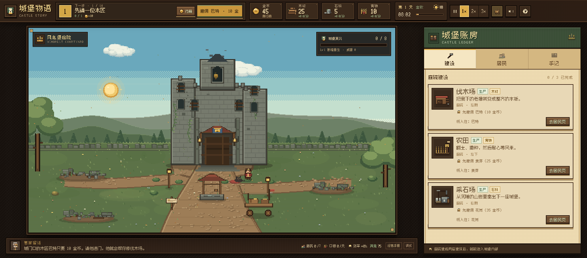

# 城堡物语 · 废墟上的王冠 v4

**在线试玩：<https://gigige1999.github.io/midagetown/>**

一款单页 HTML 像素风城堡模拟经营游戏。从断墙、木匠和 45 枚金币开始，修伐木场、卖木材、开石场、修复城堡，最后把风息堡变成一座有菜单、有商铺、有上下六层扩建区、有满意居民和丰收庆典的城堡。




## 运行

直接双击 `index.html` 即可；也可以：

```bash
python3 -m http.server 8765
# 浏览器打开 http://127.0.0.1:8765
```

不需要安装依赖或构建。场景、人物、图标全部由 Canvas 程序化绘制。

## v4 新增

1. **行商两页**：卖出 / 买入分开；木材、石料、食物都能买入，每种物资每天有购买上限，黎明刷新。
2. **城堡等级与威望**：居民、区域、商铺、扩建房间和升级都会提高威望。城堡外观随等级增加旗帜、火盆、花箱、石像、金色饰边和侧塔。
3. **生产区域扩建**：伐木场、农田、采石场可以升级，产速每级 +30%，场景里会出现更多木堆、田垄、矿石和设施。
4. **房间升级**：所有城堡房间可升到 Lv.5，增强口粮减免、生产、售价、满意度和威望。
5. **更多菜谱**：8 道菜，购买后提高居民金币收入和满意度。
6. **多层扩建**：每层 8 个房间位，填满一层后解锁下一层，最多 6 层；房型可选位置、可重复。
7. **8 种扩建房型**：厕所、餐厅、客房、宿舍、工坊、花园房、图书室、浴场。
8. **基础设施与满意度**：每层有房间后，最好配置厕所和餐厅；缺失会直接降低效率和满意度。满意度低于 30 时，面具居民会离开。
9. **商铺消耗食物**：商铺增加金币，也会增加每日食物消耗。
10. **调试模式**：底部「调试」或按 `~`。建造立即完成，可一键加资源、满级、解锁区域、加床位、邀请居民、跳过一天。
11. **丰收庆典动画**：所有主线居民和面具居民会聚集在城堡门外，伴随彩纸、灯笼和人群动效；点击「点亮最后一盏灯」进入结局。

## 经营主线

- 顶栏左侧显示当前目标，金色按钮直接雇人、建造、卖货或进入城堡。
- 伐木 → 卖木材换金币 → 请石匠 → 开采石场 → 请农夫解决口粮。
- 庭院建成两座建筑后，左上角出现「庭院 / 城堡内」。
- 依次修复厨房、书房、兵营、账房、礼拜堂。
- 修复全部房间后开放「扩建层」，左上角出现楼层切换。
- 全部区域完成后举办丰收庆典。

## 满意度与离开

满意度受这些因素影响：

- 是否吃饱；
- 菜单数量；
- 剩余床位；
- 每层是否配置厕所/餐厅；
- 扩建房间的满意度加成（如浴场、花园房）；
- 城堡房间升级等级；
- 商铺服务。

满意度低会降低生产效率和居民金币收入。低于 30 时，面具居民可能离开；主线居民不会离开。详情在「居民」页。

## 扩建层规则

- 每层 8 个房间位，F1–F6 逐步解锁。
- 建满当前层后解锁下一层。
- 房间类型可以重复，位置由玩家选择。
- 每层有房间后，缺少厕所/餐厅会触发警告和效率/满意度惩罚。
- 客房 +2 床位，宿舍 +4，花园房 +1；有床位才能邀请面具居民。

## 调试模式

- 底部「调试」按钮，或按 `~` / `Ctrl+Shift+D`。
- 调试模式下，新建造立即完成。
- 调试面板提供：全资源 +1000、完成所有建造、所有区域 Lv.MAX、解锁全部区域、加客房并邀请、补满食物、跳过一天。

## 界面预览


## 操作

- 跟着顶栏金色按钮走。
- 点击右上角行商：卖出/买入、每日限购。
- 点击场景里的建筑、居民、猫、城堡查看详情。
- 城堡内点击房间标签修复；扩建层点击空房间选择房型；左上角切换楼层。
- 空格暂停；`1` `2` `3` 调速；`M` 静音。
- 自动存档在 `localStorage`（存档版本 4；旧 v3 扩建数据会自动迁移）。

## 文件

- `index.html` — 页面入口
- `styles.css` — 像素 UI、布局、庆典/调试样式
- `js/data.js` — 资源、居民、建筑、菜单、商铺、扩建房型、楼层、事件
- `js/game.js` — 循环、交易、菜单、升级、满意度、扩建、居民、庆典、存档
- `js/scene.js` — 庭院、主厅、扩建层、城堡等级外观
- `js/icons.js` — 程序化图标、居民/面具头像
- `js/audio.js` — WebAudio 音乐和音效
- `游戏设计文档.md` — 完整策划与数值说明

## 字体

中文像素字体使用 [Fusion Pixel Font](https://github.com/TakWolf/fusion-pixel-font)（SIL OFL 1.1），授权见 `assets/fonts/OFL.txt`。
