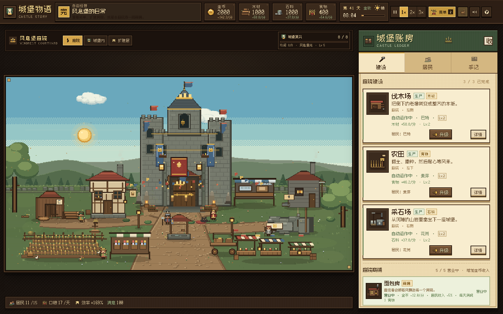
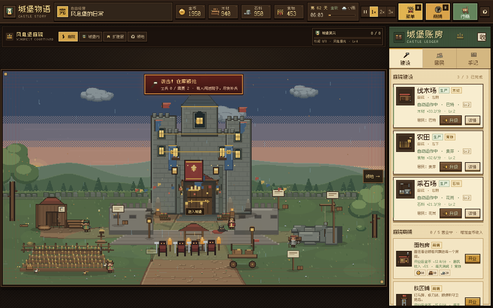
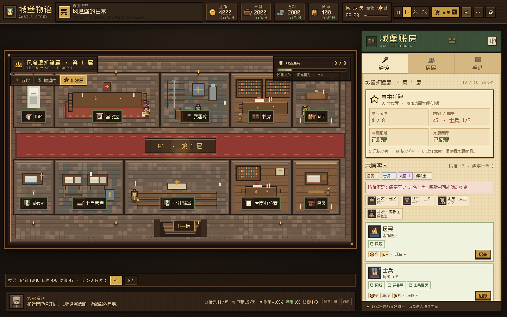
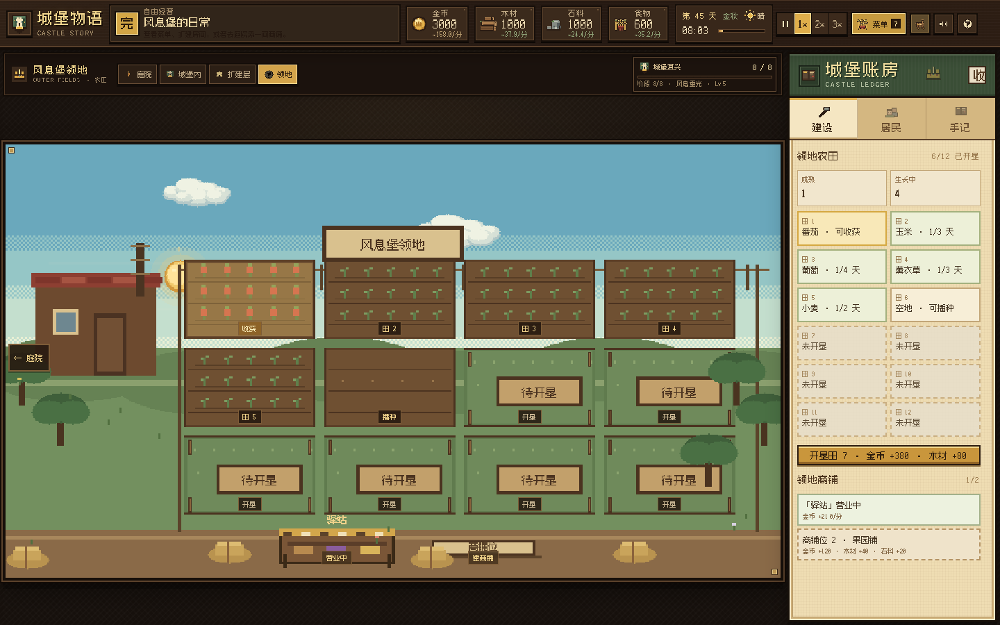
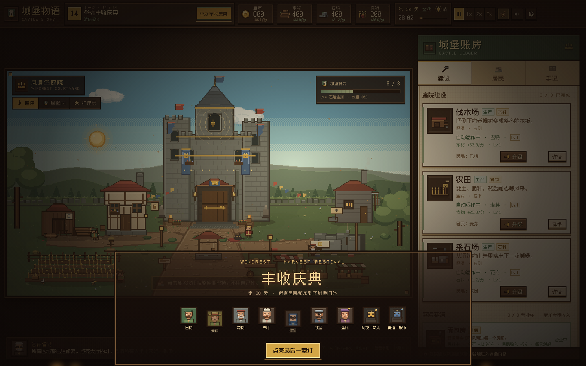

# 城堡物语 · 废墟上的王冠 v5

一款单页 HTML 像素风城堡模拟经营游戏。修庭院、卖资源、修复城堡，然后把城堡向上扩建为有不同尺寸房间、不同客人职业、防御与偷窃、传教士与产能、以及阶段外观变化的多层城堡。

**在线试玩：<https://gigige1999.github.io/midagetown/>**








## 运行

直接双击 `index.html`；或：

```bash
python3 -m http.server 8765
# http://127.0.0.1:8765
```

无依赖、无构建。场景、人物、图标全部由 Canvas 程序化绘制。

## v5 重点

### 1. 城堡阶段会改变外观（领地整体扩张）

每完成一个区域，城堡都会进入下一阶段，并增加新的外观元素：

- 门灯、旗帜、庭院花圃、城门彩旗；
- 大门上方的家族旗帜、亮窗、金环；
- 石像、金冠、彩灯；
- 高等级时还会加建两侧塔楼。

进度浮窗会显示 `阶段 X/8`、城堡等级和威望；阶段提升时会有专门提示。

### 2. 扩建层：每层 10 个不同大小的房间位

- 每层 10 个位置，尺寸分为 S / M / L。
- 小位置只能放小型房；中型位置可放小/中型；大型位置可放任意房。
- 房间类型可重复，位置由玩家选择。
- 一层建满 10 间后，下一层会自动解锁；可持续向上扩建。
- 点击画面底部的楼梯可以直接进入下一层；还没建满时会提示先完成本层。
- 16 种房间：厕所、餐厅、卧室、宿舍、工坊、花园房、图书室、浴场、武器库、书房、会议室、小礼拜堂、民居、士兵营房、大臣办公室、静修室。

### 3. 地板与装修有独立入口

- 场景上方新增「装修」按钮，不放进房间升级流程。
- **城堡内部**：一次购买城堡内部装修，整套大厅/房间地砖与中央地毯同步变化。
- **扩建层**：按楼层独立购买地板皮肤，默认灰石砖；暖木、黑白棋盘、青苔石、皇家红石。
- 购买只解锁当前层；另一层需要单独购买。
- 场景会同步改变地砖、走廊地毯、房间地面色调，并在楼层标题显示皮肤名。
- 城堡大厅入口同时有「城堡装修」按钮，不占用房间升级弹窗。
- 大厅装修只按套装出售：每个套装会同时改变地板、墙面整体配色和陈设（皇家红金 / 暖木田园 / 棋盘书卷 / 苔石礼拜），买完立即整厅换色。

### 4. 四类客人，各有不同需求与效果

| 客人 | 本层房间要求 | 效果 |
|---|---|---|
| 居民 | 民居 | 提高金币收入 |
| 士兵 | 厕所 + 武器库 + 士兵营房 | 提高防御，降低被偷窃概率 |
| 大臣 | 会议室 + 书房 + 大臣办公室 | 每个 +6% 生产；房间和招募更贵 |
| 传教士 | 小礼拜堂 + 静修室 | 恢复居民产能，提高满意度 |

- 每位客人都会消耗食物，并占用所在楼层的一个床位。
- 不同职业有不同头像、服装和职业道具，会在对应房间/区域活动。
- 客人的招募条件按“当前楼层”的房间计算，因此每层都需要做配比规划。
- 角色房：民居（居民）、士兵营房（士兵）、大臣办公室（大臣）、静修室（传教士）。

### 5. 防御、偷窃、传教士与户外巡逻

- 士兵会穿着头盔、带着武器在城堡门外站岗和沿路巡逻，不再是只出现在房间里的小图标。
- 士兵与武器库提供防御。
- 居民越多，需要的士兵越多；士兵不足时，隔壁村可能在黎明偷走木材、石料、食物和金币。
- 没有传教士时，居民产能 -20%；招募传教士后恢复。
- 城堡底部楼层栏会实时显示防御、士兵需求和传教士数量。

### 6. 顶栏菜单、菜谱解锁与每日消耗

- 右上角现在有三块大号动作按钮：菜单、商铺、行商；不再只靠小图标。
- 商铺按钮打开「商铺一览」，可直接查看全部庭院商铺并开业。
- 厨房修好后，菜单按钮变成金色并显示已解锁菜谱数量。
- 12 道菜都有独立像素素材：蘑菇浓汤、蜂蜜面包、香草烤肉、苹果派、烤蘑菇串、奶油南瓜汤、蜂蜜烤鱼、皇家炖锅，以及番茄意面、玉米面包、葡萄派、薰衣草茶。
- 菜谱随居民数量逐步解锁，例如浓汤 2 人、面包 4 人、烤肉 6 人，后期菜需要更多居民。
- 每道菜每天都会额外消耗食物（1–3 份/天），越丰富的菜单食物压力越大；这些消耗已计入每日口粮。
- 菜谱增加居民收入和满意度。

### 7. 房间升级、拆除与视觉变化

- 点击扩建层任何已建房间，弹窗里会出现「升级房间」按钮。
- 每个房间最高 Lv.3；升级提升床位、收入、生产、防御或满意度。
- 升级后的房间会明显多出：
  - 地毯、盆栽、边桌、烛台、挂毯；
  - 容量房每级多一张床；
  - Lv.3 增加吊灯、壁旗和柜子；
  - 武器库、书房、大臣办公室等有对应家具。
- 城堡大厅每个房间都有独立陈设：
  - 书房：书架、书桌、羽毛笔、地球仪、挂钟、窗；
  - 礼拜堂：彩窗光斑、祭坛、长椅、烛台、洗礼盆；
  - 兵营：武器架、盾甲、行军床、箱子、窗；
  - 账房：罐架、木桶、麻袋、绳圈、账本；
  - 厨房：烟罩、炉火、大锅、挂锅、操作台、面包篮；
  - 大厅：长桌、桌旗、餐具、吊灯、壁炉、盔甲架、大门；
  - 卧室与营房：四柱床、衣柜、洗手台、猫。
- 所有房间家具都做了矩形裁剪，不会越过墙面；升级装饰只贴在墙上，不再压住家具。
- 小尺寸房间也保留紧凑床位与家具，不再只显示空壳。
- 房间支持「拆除」：确认后返还一半建造材料；如果拆除职业房或床位后不再满足客人条件，相关客人会离开。

### 8. 楼层导航、楼梯与可收起侧边栏

- 「风息堡庭院/扩建层」位置牌、庭院/城堡内/扩建层切换、城堡复兴进度全部移到场景上方独立条，不再覆盖 canvas。
- 楼层导航移到游戏画面下方的独立条，不再遮挡场景；无限扩建时楼层按钮可横向滚动。
- 点击扩建层楼梯可直接前往下一层；本层未建满时会提示先建满。
- 建设页不再重复放楼层按钮。
- 账房右上角可以收起侧边栏；收起后场景自动放大，右侧留一个「账房」按钮重新展开。
- 扩建侧栏改为：2 个关键数值 + 一条警告 + 招募按钮 + 10 个房间格子；不再显示长描述和客人详情。
- 招募客人改为一个按钮打开弹窗，房间详情/升级/拆除在点击房间后的弹窗里；地板与装修独立放在场景上方入口。
- 已移除侧边栏底部的玩法说明/庆典回顾/重新开始、底部管家提示条和整个日常状态底栏；场景因此获得更多高度。
- 帮助入口只保留顶部一个，调试模式用键盘打开。

### 9. 更多集市与户外士兵

- 庭院商铺从 3 间增加到 5 间：
  - 面包房、铁匠铺、杂货铺；
  - 鱼摊：城堡阶段 5 开放；
  - 花摊：扩建到第 2 层开放。
- 新商铺有独立摊位外观、收入和居民加成，也会增加每日食物消耗。
- 士兵会在户外城门前站岗，部分沿前庭巡逻，和室内职业活动形成呼应。

### 10. 领地农田与领地商铺

- 新增「领地」场景：一页有 12 块可开垦的田，从第 1 块开始逐块扩建，直到全部开垦。
- 开垦一块田消耗金币和木材，开垦后可以播种；没开垦的田会显示「待开垦」。
- 8 种作物，部分随居民数量解锁：
  - 小麦、胡萝卜、南瓜、草药；
  - 番茄（4 居民）、玉米（8）、葡萄（12）、薰衣草（16）。
- 每天可以给空地选择一种作物；作物按天数生长，成熟后手动收获，收成组合不同。
- 点击田地会弹出管理面板：
  - 未开垦：花费资源开垦；
  - 已开垦：可播种/收获，也可把田地升到 Lv.3，提高收成；
  - 田地升级有独立成本、等级和场景标记。
- 作物会记录首次收获，用来解锁新菜谱。
- 新增 4 道作物菜谱：番茄意面、玉米面包、葡萄派、薰衣草茶。
- 新菜谱和菜品会按角色提供不同加成：居民收入、士兵防御、大臣生产、农夫收成、厨师菜单收入、传教士满意度。
- 新增 2 类新居民：
  - 农夫：民居 + 花园房，收获 1 种作物后解锁，提高收成；
  - 厨师：民居 + 餐厅，拥有 6 道菜谱后解锁，提高菜单收入。
- 领地底部有 2 个商铺位，可建驿站/果园铺；商铺计入收入和每日食物消耗。
- 庭院场景右侧箭头可进入领地，领地左侧箭头返回庭院。
- 庭院城堡门是点击热区，可直接进入城堡大厅。


### 12. 角色动线、关系与袭击

- 不同职业在庭院里有不同动线：
  - 士兵沿城门与墙根巡逻；
  - 大臣往返议事厅与告示牌；
  - 传教士在礼拜堂与水井之间；
  - 农夫走向农田，厨师在厨房与面包房之间；
  - 居民在井边、门口与花圃之间闲逛。
- 角色相遇时会冒随机对话气泡，内容随职业变化。
- 系统记录每对客人的好感：
  - 好感高会恋爱（♥）；
  - 好感低会吵架（✕）；
  - 关系变化会写进手记并弹出提示。
- 「居民」页新增「城堡关系」列表，显示恋爱 / 不和 / 熟络。
- 防御不足发生袭击时：
  - 场景顶部弹出红色「袭击！」警示条；
  - 屏幕边缘出现红色脉冲；
  - 城门外的路上会画出举着火把的袭击者。


### 13. 自由摆放的扩建层

- 扩建层不再固定 10 个格子，而是 **每层 12 间上限的自由摆放**：
  - 在「房间商店」购买房间后，光标变成放置预览；
  - 绿色表示可以放，红色表示碰撞或越界；
  - 房间按 8px 网格吸附，不能越过楼层边界、楼梯和其他房间。
- 房间有三种占地：S（88×104）、M（136×104）、L（208×104）。
- 「本层房间」列出已建房间，点击可升级或拆除。
- 房间与装饰改成可视化弹窗商店：卡片带尺寸预览、说明和价格，购买后进入放置模式；侧边栏只保留本层信息与入口按钮。
- 新增「装修模式」：开启后可拖动**已购买的房间和装饰物**调整位置，也可逐块铺地砖；碰撞规则与购买放置一致。
- 房间弹窗新增「移动位置」按钮，点击直接进入装修模式并提示拖动。
- 地砖按包购买（每包 20 块），选中一种后点击地面逐块铺设，只作用于当前楼层；每层独立库存。
- 「装饰商店」出售立灯、盆栽、武器架、挂画、雕像、小地毯、烛台等纯装饰物：
  - 买一件只能摆一件；
  - 只属于当前楼层，换层不通用；
  - 已摆装饰可在列表里点掉。
- 商铺新增收益摘要：金币/分、居民收入、生产效率、每日食物一目了然。

### 14. 调试模式

- 底部「调试」或按 `~` / `Ctrl+Shift+D`。
- 金币与物资显示为「无限」，所有建造/升级/招募/购买都不扣资源。
- 建造立即完成；面板可一键满级、解锁区域、加床位、邀请居民、跳过一天。

## 其他系统

- 行商分「卖出 / 买入」两页，木材、石料、食物均可买入，每天有限购。
- 伐木场、农田、采石场可升级，每级产速 +30%。
- 城堡房间可升级，增强效果与满意度。
- 商铺增加金币，也会增加每日食物消耗。
- 满意度由食物、菜单、床位、基础设施、房间等级、浴室/花园、商铺和客人职业共同决定；低于 30 时客人会离开。

## 操作

- 跟着顶栏金色按钮走主线。
- 点击右上角行商：卖出/买入。
- 场景上方切换「庭院 / 城堡内 / 扩建层 / 领地」。
- 扩建层底部选择楼层；点击空位置建造房间；右侧账房招募客人。
- 空格暂停；`1` `2` `3` 调速；`M` 静音。
- 自动存档在 `localStorage`（存档格式 v4，旧扩建数据会自动迁移）。

## 文件

- `index.html` — 页面入口
- `styles.css` — 像素 UI、布局、楼层栏、侧边栏收起、庆典/调试
- `js/data.js` — 资源、居民、房间、客人职业、商铺、菜单、事件
- `js/game.js` — 循环、交易、升级、扩建、客人、防御、满意度、庆典、存档
- `js/scene.js` — 庭院、主厅、扩建层、城堡阶段外观、职业客人
- `js/icons.js` — 程序化图标、职业头像、菜谱素材
- `js/audio.js` — WebAudio 音乐和音效
- `游戏设计文档.md` — 策划、数值与视觉说明

## 字体

中文像素字体使用 [Fusion Pixel Font](https://github.com/TakWolf/fusion-pixel-font)（SIL OFL 1.1），授权见 `assets/fonts/OFL.txt`。
